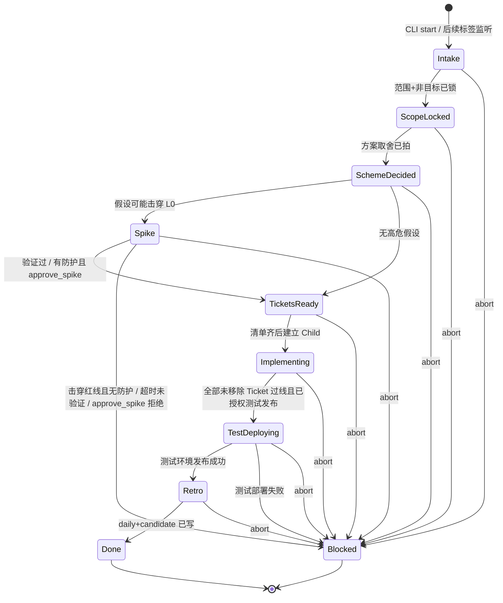
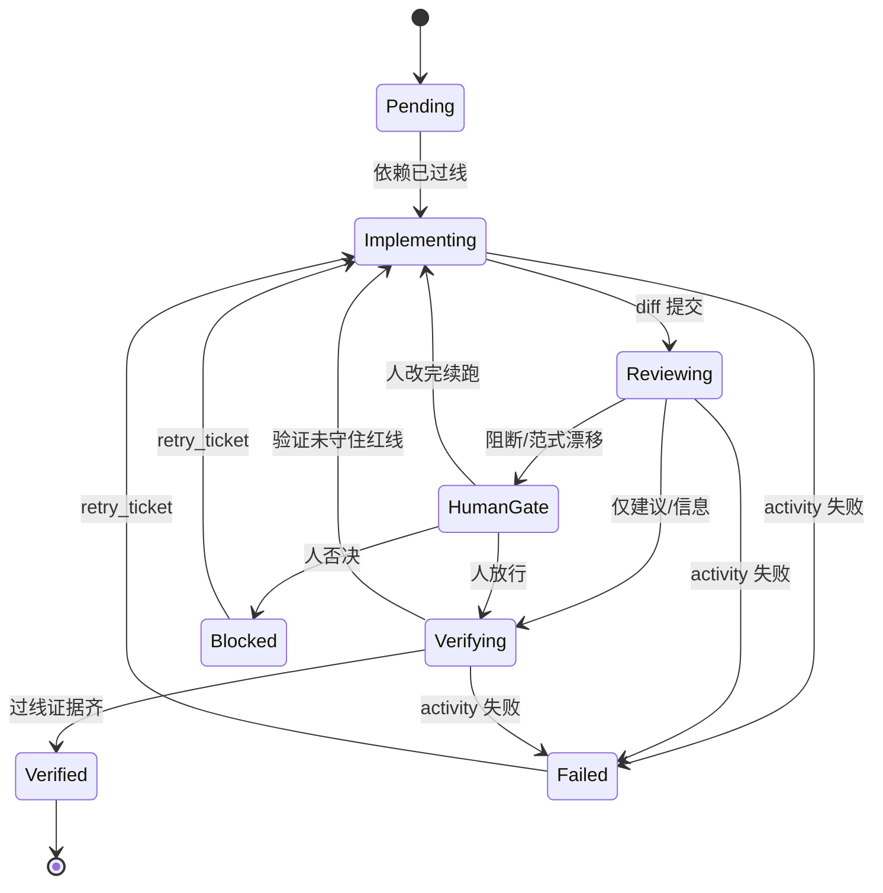

# dev-pipeline

公司内部 AI Native 开发流程的编排仓库：以 Temporal 为内核，调度写码 Worker、Code Review Worker、验证与 Retro，并与 Jira、RAG 及其他 Agents 配合。

本仓库独立于 `agent-platform`。后期再对接，当前不拷贝、不实现 Agent Session 运行时。

Jira 项目：[dev-pipeline（DP）](https://weiperfect007.atlassian.net/jira/software/projects/DP/boards/34)。票只写在 Jira，本仓库不维护 `TASKS.md`。Jira 只镜像流程状态，不当编排器。

## 当前阶段

[DP-9](https://weiperfect007.atlassian.net/browse/DP-9) 父 Workflow 骨架、[DP-10](https://weiperfect007.atlassian.net/browse/DP-10) 人工 Signal / reopen，[DP-11](https://weiperfect007.atlassian.net/browse/DP-11) 幂等执行（键为 `ticket_id+execution_id`），以及 [DP-12](https://weiperfect007.atlassian.net/browse/DP-12) 预算闸门已按测试落地：合法阶段转移（含已锁定的 `TestDeploying`）、人工门禁，以及 [DP-26](https://weiperfect007.atlassian.net/browse/DP-26) 的最小编排规则（依赖拓扑、并行、单张失败不自动取消同胞）。用 CLI 根据 Jira key 启动一条进入 Intake 的父执行见 [DP-13](https://weiperfect007.atlassian.net/browse/DP-13)。Intake 把原始诉求整理成规范化 Story 草稿（缺项标 `待证`）见 [DP-15](https://weiperfect007.atlassian.net/browse/DP-15)。父执行阶段变更镜像回对应 Jira 票见 [DP-14](https://weiperfect007.atlassian.net/browse/DP-14)。本地开发脚手架与必填配置根目录见 [DP-29](https://weiperfect007.atlassian.net/browse/DP-29) 与 `docs/dev-setup.md`。

真实 Coding / Review LLM Worker、Cursor CLI 运行时和 `agent-platform` 对接尚未实现。不要把本仓库当成整条流水线已经完成。

协作约定与代码规范已从 `common-worker` / `agent-platform` 迁入并适配，包名 `dev_pipeline`。Jira 项目 Key 已定为 `DP`。`docs/CHARTER.md` 中的 L0 已于 2026-11-10 冻结。远程仓库为 [JoeSmile/dev-pipeline](https://github.com/JoeSmile/dev-pipeline)。

开工先读 `plans/AI-CONTEXT.md`、`AGENTS.md`、`docs/CHARTER.md`。状态机与契约见下文与 `docs/architecture/dev-pipeline.md`。

## 推荐形态

父 Workflow `DevPipelineWorkflow` 只管阶段、门禁、Jira 同步、预算与幂等。一条父执行对应一张 Story。写码、RAG、双 Review、验证是 Activity 或 Child，不把 agent loop 写进 Workflow。每张实现 Ticket 由独立、可幂等的 Child（`TicketWorkflow`，幂等键 `ticket_id + execution_id`）执行。

Child 循环是 `Pending` → `Implementing` → `Reviewing` →（必要时 `HumanGate`）→ `Verifying`；父执行在 `TicketsReady` 之后以聚合阶段 `Implementing` 等待。启动清单里的每张 Ticket 都是必做的；只有 `drop_ticket` 能在启动后把它从清单中移除。全部未移除 Ticket 验证过线后，父执行等候人工 Signal `authorize_test_deploy`，授权后才进入 `TestDeploying` 并发布到测试环境。Coding Worker 只碰授权 worktree；Review Worker 默认只读 diff。互辩 / RAG / 多模型的预算闸门挂在父 Workflow：超限即停并记一条 Bad。

多 Ticket 按依赖拓扑执行：无依赖可并行；有依赖的 Ticket 不得提前开工（Child 直接启动且依赖未过线时停在 `Pending`）。单张失败不自动取消同 Story 其他未受影响的 Ticket，但 Story 不能进入 `TestDeploying` 或 `Retro`，直到失败被处理（重试、人工 `drop_ticket`，或 `abort`）。

## 幂等执行（DP-11）

同一 Ticket 重跑的键是 `ticket_id+execution_id`（`ticket_workflow_id`），同时用作 Child workflow id。父执行 id 仍是 `story_workflow_id(story_id, execution_id)`。Child 启动使用 `WorkflowIDReusePolicy.REJECT_DUPLICATE`：已完成或仍在运行的同一 id 不得再开新 run。

- **同键、仍在进行中**：视为重入。复用已有 handle / 已启动的 Child，不创建第二份副作用，也不重复发送 `dependencies_satisfied`。
- **同键、已完成**：返回已有结果，不开新分支 / PR / worktree 声明。
- **不同 `execution_id`（含 `reopen`）**：这是新一次执行、新键。不得继跑旧 execution，也不得复用旧工作区声明。

`retry_ticket` 是同一次执行内对同一 Child 的重试，不分配新的 `execution_id`。工作区 / 分支 / PR 目前只是按该键记录的声明（不访问 git）；真实写码 Worker 与扫尾见后续票。

## 预算闸门（DP-12）

互辩、检索（RAG）与多模型调用的预算闸门挂在父 Workflow。计量单位为可配置的 `tokens` / `calls` / `cost`（至少启用一个），限额写在配置根目录的 `budget.toml`。缺失或非法配置会以中文错误可见地失败，不会使用隐藏默认限额继续执行。样例见 `docs/examples/budget.toml`；其中的数字均为**待证**占位，须经负责人签批后才视为正式限额。

耗费用路径通过父执行上的 Update `start_costly_path` 启动对应桩 Activity（`run_debate` / `run_rag` / `run_model_call`）。任一已启用单位用尽时立即停止这些路径，快照记录 `Bad` 与超限原因，不再启动后续外部模型或检索，也不会静默继续计费。超限不自动取消同 Story 其他未受影响的 Ticket。某条路径返回「无新证据」时只停止该路径，不再继续消耗预算。

已用、限额、剩余、已停止路径和 `last_breach` 挂在现有父执行查询快照的 `budget` 字段上，不另开第二套 Query。真实 RAG / 多模型调度细节不在本票范围。

## 用 CLI 启动进入 Intake（DP-13）

Jira 只提供 key，不当编排器。用本仓库的 CLI 显式启动一条 `DevPipelineWorkflow`，执行进入 Intake。自动按 Jira 标签开跑是 [DP-39](https://weiperfect007.atlassian.net/browse/DP-39)，本入口不实现监听器。CLI 与后续监听路径共用同一套 Intake 形状（Jira key、提出人、原始诉求、来源、是否带自动开跑标签；缺项标 `待证`）；CLI 填写 `source=cli`。进入 Intake 后会把原始诉求整理成规范化 Story 草稿（至少包含要解决什么、已知约束、缺项列表；缺项标 `待证`，不臆造验收），挂在查询快照的 `story_draft` 上，作为后续 `lock_scope` 的输入。本阶段不锁范围、不开始编码。

可复制的验收命令（先准备好已存在的配置根目录，并启动 Worker，步骤见 `docs/dev-setup.md`）：

```powershell
dev-pipeline start --jira-key DP-13 --config-root D:\pipeline-config
```

等价入口：`python -m dev_pipeline.cli start --jira-key DP-13 --config-root D:\pipeline-config`。可选 `--execution-id`（省略则生成 UUID 并打印）、`--temporal-target`（默认 `localhost:7233`）、`--task-queue`（默认 `dev-pipeline`）。成功时会打印 `workflow_id`、`execution_id` 和 Jira key。父执行 id 仍是 `story_workflow_id(story_id, execution_id)`。

配置根目录缺失、非法，或缺少合法 `budget.toml` 时立刻以中文错误非零退出，不会回退默认路径。Temporal 不可达、Jira key 非法、或目标 workflow id 已存在时同样可见地失败并中止，不会把失败说成「可能已存在」，也不会接入已有执行当作成功。查询 / Signal CLI 见后续 [DP-28](https://weiperfect007.atlassian.net/browse/DP-28)。

## 把阶段镜像回 Jira（DP-14）

Temporal History 是阶段真相；Jira 只是给人看的镜像，不当编排器。父执行每次阶段变更（含启动后的 Intake）后，会把当前阶段同步到 Intake 载荷上的那张 Jira 票。没有 Jira key 时不同步。

默认镜像是一条幂等、带前缀 `【DevPipeline 阶段镜像】` 的评论（同一 `execution_id` 只维护一条，重试更新而不重复发）。不把 DevPipeline 阶段映射成 Jira 工作流状态，以免撞上项目工作流。若配置根目录的 `jira.toml` 填写了 `stage_field`，会同时写入该自定义字段；字段的具体名称 / ID 仍为**待证**，必须可在配置中覆盖。样例见 `docs/examples/jira.toml`。令牌放在配置根目录下的独立文件，不进命令行、History 或证据日志。

同步在 Activity 中完成，带显式超时并允许重试。配置缺失或非法会以中文错误可见地失败，不会挂起，也不会当成成功。重试耗尽后父执行阶段不变，现有查询快照的 `jira_mirror` 字段记录 `镜像滞后` 和原因，并尽最大努力在票上留下 `【DevPipeline 镜像滞后】` 评论。Jira 上过期或被手改的值不会回写 Workflow。入站的评论 / 字段变更不产生 Signal，也不触发阶段转移。

## 流程状态机

父执行与 Child 是两台状态机，不要画在同一张图里。父执行进入 `TestDeploying` 的边是 `Implementing → TestDeploying`，不是 `Verifying --> TestDeploying`。

### 父 Workflow（Story）



### Child Workflow（Ticket）



阻断项打回须经 `HumanGate`（`review_override` 打回），不能从 `Reviewing` 自动跳过门禁回到 `Implementing`。`Reviewing` 若仅有建议/信息，可直接 `Verifying`；有阻断项或范式漂移必须 `HumanGate`。验证未守住红线则回到 `Implementing`。Child 在依赖未过线时停在 `Pending`，不得直接进入 `Implementing`。

全部未移除 Ticket 验证过线后，父执行仍停在聚合阶段 `Implementing`，等候人工 Signal `authorize_test_deploy`。授权后进入已锁定名称的 `TestDeploying`（2026-11-10 锁定，规则见 [DP-43](https://weiperfect007.atlassian.net/browse/DP-43)）并发布到测试环境。没有该 Signal 不得发布，也不得进入 `Retro`。只有测试部署成功才允许进入 `Retro`；测试部署失败不得进入 `Retro`。不存在生产部署转移。可进入 `Blocked`：红线被击穿且无防护、测试部署失败，或人工否决 / `abort`。`abort` 会取消仍在运行的 Child，再以可回放结果进入 `Blocked`。

## 阶段契约

| 阶段 | 输入 | 输出（进下一阶段的硬条件） |
|---|---|---|
| Intake | Jira key、reporter、原始诉求 | 规范化 Story 草稿（`snapshot.story_draft`：要解决什么、已知约束、缺项列表）；缺项标 `待证`，无臆造验收。草稿是 `lock_scope` 的输入，本阶段不锁范围 |
| ScopeLocked | L0 Rule/Skill + Story 草稿 | 要解决 / 不做什么已写入执行记录（含锁定人、时间），可供 Query 与 `reopen` 只读继承；禁止未锁范围就开编码 |
| SchemeDecided | 范围 + RAG 规范/历史事故 | 取舍记录（`snapshot.scheme`：取舍说明、假设清单分级为红线级 / 局部 / 候选、拍板人、时间、检索为桩或真实命中）；无红线级可直达 TicketsReady |
| Spike（可选） | 红线级假设 | 可证伪结论写入 `snapshot.spike`；时限由可选 `spike.toml` 配置（缺省为待证占位，示例为半小时～半天中的 4 小时）。验证过则进 TicketsReady；击穿红线且无防护，或超时未验证，进入 Blocked；有防护时须经 `approve_spike` 才能进 TicketsReady。过线后不直接 Implementing，不派 Coding Child |
| TicketsReady | 已拍方案 | Ticket 清单：目标、验收、依赖、I/O 契约；清单齐才能进 Implementing 并为每张必做票建立 Child。清单未齐时等候 `submit_tickets`。票写入 Jira 项目 `DP`，不写 `TASKS.md` |
| Implementing | 单张 Ticket + worktree 权限 | 分支、diff、单测、回滚说明；幂等键 `ticket_id + execution_id`。父执行在此聚合等待 Child 循环；全部未移除 Ticket 过线后等候 authorize_test_deploy |
| Reviewing | diff + L0 + 本 Story 局部约束 | 双 Agent 并行：阻断 / 建议 / 信息 + 引用规则条文；无新证据就停 |
| HumanGate | 仅阻断项或跨模块/范式漂移 | 放行 / 打回 / 否决（Signal） |
| Verifying | 验收步骤 + L0 红线 | 「红线 ↔ 证据」至少一行；命令/现象可复现。全部未移除 Ticket 过线且已授权后，由父执行从聚合 `Implementing` 进入 `TestDeploying`，而不是直接 Retro |
| TestDeploying | 全部未移除 Ticket 已验证过线，且已收到 `authorize_test_deploy` | 测试环境可达地址；失败则阻断，不得进入 Retro。禁止任何生产发布 |
| Retro | 当日证据（git、Jira、Codex session、评审）与成功的测试部署 | `docs/knowledge/daily/YYYY-MM-DD.md`；candidate 更新；全局草案等签批 |

## 人工 Signal

人只出现在这些点：

- `lock_scope` / `decide_scheme`：锁范围、拍方案
- `submit_tickets`：TicketsReady 提交完整拆票清单（目标、验收、依赖、I/O 契约）
- `approve_spike`：击穿红线且已有防护时，是否接受防护后继续；验证过或无防护失败时不使用该 Signal
- `review_override`：阻断项或范式漂移放行/打回/否决
- `authorize_test_deploy`：全部未移除 Ticket 过线后，确认测试环境发布
- `promote_rule`：候选升 L0 / 全局 Skill（默认禁止自动升；本骨架仅记录请求，自动晋升一律拒绝）
- `retry_ticket` / `drop_ticket`：重试失败 Ticket，或把它从清单中移除
- `abort` / `reopen`：中止或重开同一 Ticket / Story（必须开新 execution，不复用已乱掉的一次）

`abort` 会取消仍在运行的 Child，把父执行带入 `Blocked`，并留下可回放记录。本骨架尚未回收 worktree / 处理远程 PR（见 [DP-30](https://weiperfect007.atlassian.net/browse/DP-30)）。`reopen` 只在 `Blocked` 或 `Done` 时接受，且必须带一个不同于当前的新 `execution_id`；接受后由 Activity 启动一条独立的新父执行，旧执行保持终态、不会被继跑。若旧执行已锁定范围，新执行只读继承该记录（要解决 / 不做什么 / 锁定人 / 时间），不再等待 `lock_scope`，也不得改写已锁范围。仍在运行时 reopen 会被拒绝（须先 `abort`）。错误阶段或非法 payload 的 Signal 一律拒绝，记入可查询的 `last_rejection`，不改变当前阶段。

### Signal payload schema

字段与拒绝条件以代码为准：`src/dev_pipeline/signal_schemas.py`。

| Signal | Payload | 必填 | 合法阶段 | 拒绝条件 |
|---|---|---|---|---|
| `lock_scope` | `ScopeLock` | `in_scope`、`out_of_scope`、`locked_by` | Intake | 缺字段、类型错误、范围已锁或只读继承后、阶段不对。`locked_at` 由工作流写入，不取自 payload |
| `decide_scheme` | `SchemeDecision` | `tradeoff`、`hypotheses`（分级：红线级 / 局部 / 候选）、`decided_by` | ScopeLocked | 缺字段、类型错误、未知分级、布尔值与分级冲突、已拍过、阶段不对（含未锁范围）。`decided_at` 由工作流写入，不取自 payload。检索标记本票记为 `桩`。无红线级假设进入 TicketsReady；有红线级假设进入 Spike |
| `approve_spike` | `ApproveSpikeRequest` | `accepted` | Spike，且正在等候防护批准 | 缺字段、类型错误、已决定、阶段不对、验证过或无需防护时尚未/不再等候批准 |
| `submit_tickets` | `TicketListSubmission` | `tickets`、`submitted_by` | TicketsReady，且清单尚未齐 | 缺字段、类型错误、清单未齐（缺目标/验收/依赖/I/O 契约、仍有待证、重复 id、未知依赖或成环）、阶段不对、清单已齐后再次提交 |
| `review_override` | `ReviewOverride` | `ticket_id`、`decision`（`approve` / `rework` / `reject`） | 对应 Child 处于 HumanGate | 缺字段、类型错误、未知 Ticket、不在 HumanGate |
| `authorize_test_deploy` | `AuthorizeTestDeployRequest`（无必填字段） | （无） | Implementing，且全部未移除 Ticket 已过线 | 阶段不对，或尚有 Ticket 未过线 / 失败未处理 |
| `promote_rule` | `PromoteRuleRequest` | `rule_name` | 运行中任意阶段 | schema 错误记入 `last_rejection`；`automatic=true` 时 Signal 已接收，但晋升动作被拒绝并记录 |
| `abort` | `AbortRequest` | `reason` | 非 Done / Blocked | 缺字段、类型错误、已经结束 |
| `reopen` | `ReopenRequest` | `execution_id`（非空且不同于当前） | Blocked 或 Done | 执行未结束（须先 abort）、id 非法、目标 workflow 已存在 |

## 硬约束（L0，2026-11-10 冻结）

完整条文与一期工作默认见 `docs/CHARTER.md`。

1. Workflow 只做确定性编排；LLM 调用、写代码、检索、测试、外部 IO 全部落在 Activity / Child Worker。
2. 禁止静默升级全局 Rule / Skill / 本宪法；晋升必须人工 Signal。
3. 写码 Worker 只能改授权 repo/worktree；Review Worker 默认只读 diff。
4. 同一 Ticket 重跑必须幂等（`ticket_id` + `execution_id`），不得重复开 PR 或改乱分支。
5. Jira 只镜像状态，不当编排器；任务对错以可复现证据为准，不把 dry-run 或历史记录当成 PASS。
6. 互辩、RAG、多模型必须有预算闸门；无新证据即停。
7. 任何生产发布禁止。测试环境受控发布须另有明确授权。
8. 未确认 `lock_scope` / `decide_scheme` 前不得编码。
9. 单文件超过 2000 行视为 Review 阻断。
10. 执行过程必须可见：当前步骤提示与定期心跳，避免被当成挂死。进度不是催办；完整思考与密钥不进 History。本骨架提供可查询快照（当前阶段、等待的 Signal、各 Ticket 状态、测试部署状态、已花费预算、Jira 镜像 / 镜像滞后、已锁范围、方案取舍记录）。

优先级：数据 / 任务不丢失 > 可观测与可回放 > 人工门禁清楚 > 迭代速度 > 极致性能。

## 技术栈（拟定）

- Python 3.12
- Temporal Python SDK
- Ruff（行宽 100）+ mypy strict + pytest

## 本地准备

远程仓库：[JoeSmile/dev-pipeline](https://github.com/JoeSmile/dev-pipeline)。L0 已冻结。Windows 是首选本地开发环境。配置根目录是必填的绝对路径，必须已经存在；缺失或无效时会立刻失败，不会回退到当前目录，也不会把它当成“可能已有”而继续。步骤见 `docs/dev-setup.md`。

本地 Temporal 默认地址为 `localhost:7233`。单元测试与 Workflow 测试使用 `temporalio.testing.WorkflowEnvironment`，不需要已启动的 Temporal 服务。也可以在 Docker 中跑同一套检查，步骤见 `docs/dev-setup.md`。

```powershell
python -m pytest
ruff check src tests
mypy
```

```powershell
.\scripts\test-docker.ps1
.\scripts\test-docker.ps1 -WithTemporal
```
