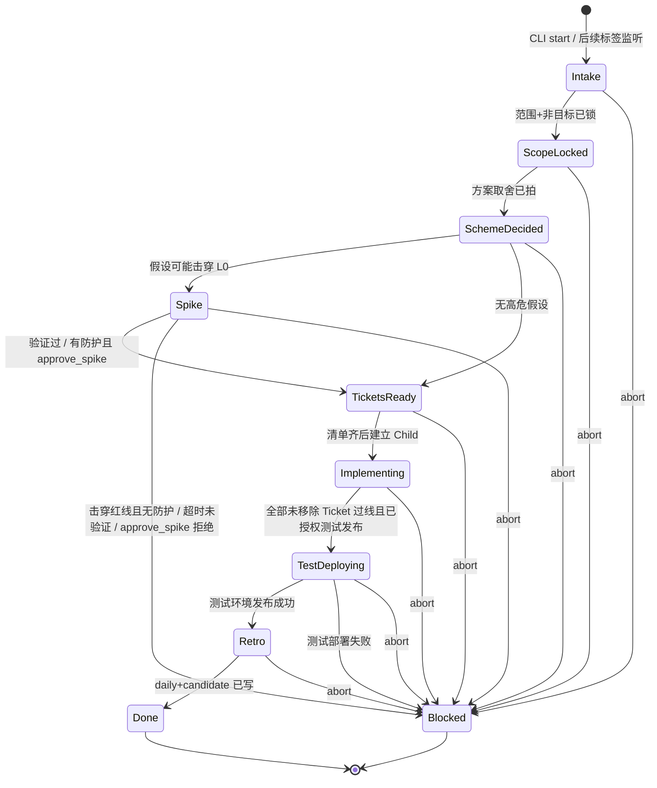
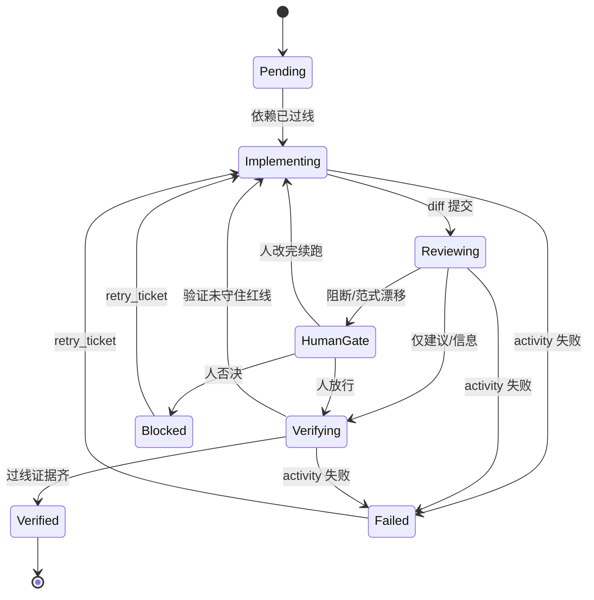

# dev-pipeline

公司内部 AI Native 开发流程的编排仓库：以 Temporal 为内核，调度写码 Worker、Code Review Worker、验证与 Retro，并与 Jira、RAG 及其他 Agents 配合。

本仓库独立于 `agent-platform`。后期再对接，当前不拷贝、不实现 Agent Session 运行时。

Jira 项目：[dev-pipeline（DP）](https://weiperfect007.atlassian.net/jira/software/projects/DP/boards/34)。票只写在 Jira，本仓库不维护 `TASKS.md`。Jira 只镜像流程状态，不当编排器。

## 当前阶段

[DP-9](https://weiperfect007.atlassian.net/browse/DP-9) 父 Workflow 骨架、[DP-10](https://weiperfect007.atlassian.net/browse/DP-10) 人工 Signal / reopen，[DP-11](https://weiperfect007.atlassian.net/browse/DP-11) 幂等执行（键为 `ticket_id+execution_id`），以及 [DP-12](https://weiperfect007.atlassian.net/browse/DP-12) 预算闸门已按测试落地：合法阶段转移（含已锁定的 `TestDeploying`）、人工门禁，以及 [DP-26](https://weiperfect007.atlassian.net/browse/DP-26) 锁定的编排粒度（父执行=Story，Child=实现 Ticket；依赖拓扑、并行、单张失败不自动取消同胞，处理前不得进 Retro）。用 CLI 根据 Jira key 启动一条进入 Intake 的父执行见 [DP-13](https://weiperfect007.atlassian.net/browse/DP-13)。Intake 把原始诉求整理成规范化 Story 草稿（缺项标 `待证`）见 [DP-15](https://weiperfect007.atlassian.net/browse/DP-15)。父执行阶段变更镜像回对应 Jira 票见 [DP-14](https://weiperfect007.atlassian.net/browse/DP-14)。本地开发脚手架与必填配置根目录见 [DP-29](https://weiperfect007.atlassian.net/browse/DP-29) 与 `docs/dev-setup.md`。

真实 Coding / Review LLM Worker、Cursor CLI 运行时和 `agent-platform` 对接尚未实现。不要把本仓库当成整条流水线已经完成。

协作约定与代码规范已从 `common-worker` / `agent-platform` 迁入并适配，包名 `dev_pipeline`。Jira 项目 Key 已定为 `DP`。`docs/CHARTER.md` 中的 L0 已于 2026-11-10 冻结。远程仓库为 [JoeSmile/dev-pipeline](https://github.com/JoeSmile/dev-pipeline)。

开工先读 `plans/AI-CONTEXT.md`、`AGENTS.md`、`docs/CHARTER.md`。状态机与契约见下文与 `docs/architecture/dev-pipeline.md`。

## 推荐形态

父 Workflow `DevPipelineWorkflow` 只管阶段、门禁、Jira 同步、预算与幂等。一条父执行对应一张 Story。写码、RAG、双 Review、验证是 Activity 或 Child，不把 agent loop 写进 Workflow。每张实现 Ticket 由独立、可幂等的 Child（`TicketWorkflow`，幂等键 `ticket_id + execution_id`）执行。

Child 循环是 `Pending` → `Implementing` → `Reviewing` →（必要时 `HumanGate`）→ `Verifying`；父执行在 `TicketsReady` 之后以聚合阶段 `Implementing` 等待。启动清单里的每张 Ticket 都是必做的；只有 `drop_ticket` 能在启动后把它从清单中移除。全部未移除 Ticket 验证过线后，父执行等候人工 Signal `authorize_test_deploy`，授权后才进入 `TestDeploying` 并发布到测试环境。Coding Worker 只碰授权 worktree；试图写到授权路径之外会被拒绝，并记入既有查询快照。按 Ticket 在授权 worktree 内交付可审查的本地分支、diff、单测证据和回滚说明，齐了才进入 Reviewing；缺项不得进入 Reviewing。默认不自动 push / 合并，未授权时不开远程 PR。进入 Reviewing 后，两个 Review Worker 并行只读审查 diff、L0 与本 Story 局部约束，结论分为阻断 / 建议 / 信息并引用规则条文；无新证据就停，不追加审查轮次。任一阻断或范式漂移、以及两条都阻断且理由冲突时，进入 HumanGate，由人裁，Workflow 不做自动仲裁。仅建议或信息时可直达 Verifying。单文件超过 2000 行必须视为阻断，不得用建议项放行。Review Worker 写入工作区必须被拒，工作区保持不变。一期 Cursor CLI 审查命令约定见 [DP-46](https://weiperfect007.atlassian.net/browse/DP-46)，本阶段只预留 `agent -p --mode=ask`，不调用现场 CLI。互辩 / RAG / 多模型的预算闸门挂在父 Workflow：超限即停并记一条 Bad。

多 Ticket 按依赖拓扑执行：无依赖可并行；有依赖的 Ticket 不得提前开工（Child 直接启动且依赖未过线时停在 `Pending`）。单张失败不自动取消同 Story 其他未受影响的 Ticket，但 Story 不能进入 `TestDeploying` 或 `Retro`，直到失败被处理。处理路径只有现有 Signal，不另开第二套机制：打回重做（`review_override` 打回或验证未过线只让该 Ticket 回到 `Implementing`；已 Failed / 否决 Blocked 的票用同一次执行内的 `retry_ticket`）、人工放弃并改清单（`drop_ticket`；`submit_tickets` 只用于 `TicketsReady` 补齐清单，清单齐后不能再用它改写清单），或对 Story `abort`。

## 幂等执行（DP-11）

同一 Ticket 重跑的键是 `ticket_id+execution_id`（`ticket_workflow_id`），同时用作 Child workflow id。父执行 id 仍是 `story_workflow_id(story_id, execution_id)`。Child 启动使用 `WorkflowIDReusePolicy.REJECT_DUPLICATE`：已完成或仍在运行的同一 id 不得再开新 run。

- **同键、仍在进行中**：视为重入。复用已有 handle / 已启动的 Child，不创建第二份副作用，也不重复发送 `dependencies_satisfied`。
- **同键、已完成**：返回已有结果，不开新分支 / PR / worktree 声明。
- **不同 `execution_id`（含 `reopen`）**：这是新一次执行、新键。不得继跑旧 execution，也不得复用旧工作区声明。

`retry_ticket` 是同一次执行内对同一 Child 的重试，不分配新的 `execution_id`。写码交付的分支名由 `ticket_id + execution_id` 推导，同键重跑复用该本地分支，不新开远程 PR、不改乱分支。未合并 worktree / 本地分支在 `abort` 后按 [DP-30](https://weiperfect007.atlassian.net/browse/DP-30) 回收；已有远程 PR 不自动关闭或合并，只记录待人工处理（标记方式待证）。开 PR 的授权条件见 [DP-31](https://weiperfect007.atlassian.net/browse/DP-31)（待证），默认视为未授权。一期写码 Activity 调 Cursor CLI 见 [DP-46](https://weiperfect007.atlassian.net/browse/DP-46)，本阶段只预留命令约定，不调用现场 CLI。

## 预算闸门（DP-12）

互辩、检索（RAG）与多模型调用的预算闸门挂在父 Workflow。计量单位为可配置的 `tokens` / `calls` / `cost`（至少启用一个），限额写在配置根目录的 `budget.toml`。缺失或非法配置会以中文错误可见地失败，不会使用隐藏默认限额继续执行。样例见 `docs/examples/budget.toml`；其中的数字均为**待证**占位，须经负责人签批后才视为正式限额。

耗费用路径通过父执行上的 Update `start_costly_path` 启动对应桩 Activity（`run_debate` / `run_rag` / `run_model_call`）。任一已启用单位用尽时立即停止这些路径，快照记录 `Bad` 与超限原因，不再启动后续外部模型或检索，也不会静默继续计费。超限不自动取消同 Story 其他未受影响的 Ticket。某条路径返回「无新证据」时只停止该路径，不再继续消耗预算。双 Review 同样只跑一轮并行审查，停止原因复用该「无新证据」表述，不另建第二套预算账本；耗费用的互辩 / RAG / 多模型仍走既有 `start_costly_path` 闸门。

已用、限额、剩余、已停止路径和 `last_breach` 挂在现有父执行查询快照的 `budget` 字段上，不另开第二套 Query。真实 RAG / 多模型调度细节不在本票范围。

## 操作 CLI：启动、Signal、状态（DP-28）

本期无人产品界面。人通过本仓库 CLI 启动、发 Signal、查状态；Temporal UI 只对照 History，不是唯一操作方式。Jira 只提供 key，不当编排器。用 CLI 显式启动一条 `DevPipelineWorkflow`，执行进入 Intake。自动按 Jira 标签开跑是 [DP-39](https://weiperfect007.atlassian.net/browse/DP-39)，本入口不实现监听器。CLI 与后续监听路径共用同一套 Intake 形状（Jira key、提出人、原始诉求、来源、是否带自动开跑标签；缺项标 `待证`）；CLI 填写 `source=cli`。进入 Intake 后会把原始诉求整理成规范化 Story 草稿（至少包含要解决什么、已知约束、缺项列表；缺项标 `待证`，不臆造验收），挂在查询快照的 `story_draft` 上，作为后续 `lock_scope` 的输入。本阶段不锁范围、不开始编码。

可复制的验收命令（Windows 第一本地环境；先准备好已存在的配置根目录，并启动 Worker，步骤见 `docs/dev-setup.md`）：

```powershell
dev-pipeline start --jira-key DP-13 --config-root D:\pipeline-config
```

等价入口：`python -m dev_pipeline.cli start --jira-key DP-13 --config-root D:\pipeline-config`。可选 `--execution-id`（省略则生成 UUID 并打印）、`--temporal-target`（默认 `127.0.0.1:7233`，即已运行的官方 Temporal）、`--task-queue`（默认 `dev-pipeline`）。成功时会打印 `workflow_id`、`execution_id` 和 Jira key。父执行 id 仍是 `story_workflow_id(story_id, execution_id)`。

锁定范围（人工门禁，无需产品界面）：

```powershell
dev-pipeline signal lock_scope --config-root D:\pipeline-config --workflow-id story-DP-13-<execution_id> --in-scope "登录校验" --out-of-scope "支付" --locked-by "Joe"
```

也可用 `--name lock_scope` 代替位置参数，或用 `--jira-key DP-13 --execution-id <execution_id>` 代替 `--workflow-id`。支持的 Signal 为既有人工信号：`lock_scope`、`decide_scheme`、`approve_spike`、`submit_tickets`、`review_override`、`promote_rule`、`authorize_test_deploy`、`abort`、`reopen`、`retry_ticket`、`drop_ticket`。复杂 payload 可用 `--payload` / `--payload-file`（UTF-8 JSON 对象）。例如审查放行：

```powershell
dev-pipeline signal review_override --config-root D:\pipeline-config --workflow-id story-DP-13-<execution_id> --ticket-id T1 --decision 放行 --decided-by "Joe"
```

非法 Signal、缺必填字段，或未到阶段时，CLI 呈现拒绝并非零退出，不改变阶段。成功时会打印新的 `stage` / `waiting_signal` / 「正在等候你确认××」。

查询同一条执行（只读，不改变状态）：

```powershell
dev-pipeline status --workflow-id story-DP-13-<execution_id> --config-root D:\pipeline-config
```

也可使用 `--jira-key DP-13 --execution-id <execution_id>`。输出包含当前步骤、最近进度行、最近心跳，以及等候确认「正在等候你确认××」或过期标记「可能无响应」（二者可区分）。配置根目录仍然必填，用于定位该 execution 证据目录下的进度日志，查询本身不会写文件或 Jira。长耗时阶段请加 `--follow` 持续刷新，避免看起来像挂了：

```powershell
dev-pipeline status --follow --workflow-id story-DP-13-<execution_id> --config-root D:\pipeline-config
```

可选 `--follow-interval`（默认 2 秒，**待证**占位，与心跳间隔占位相同）、`--follow-until waiting|stage-change|expired`（默认 `interrupt`，即 Ctrl+C 或 `--follow-max`）、`--follow-max`。跟随只查询，不改阶段，不超时自动放行门禁。

### 退出码

| 退出码 | 含义 |
| --- | --- |
| 0 | 成功：`start` 已进入 Intake；`signal` 已被接受；`status` / `--follow` 查询成功 |
| 2 | 用法或配置错误：缺必填参数、`--config-root` 缺失或不是已存在的绝对目录、payload 缺字段、未知 Signal、`budget.toml` 非法 |
| 1 | 运行失败：Temporal 不可达、找不到父执行、启动冲突、Workflow 拒绝了 Signal（阶段不变） |
| 130 | `status --follow` 被 Ctrl+C 中断 |

配置根目录缺失、非法，或 `start` 缺少合法 `budget.toml` 时立刻以中文错误非零退出，不会回退默认路径。Temporal 不可达、Jira key 非法、或目标 workflow id 已存在时同样可见地失败并中止，不会把失败说成「可能已存在」，也不会接入已有执行当作成功。Query 字段仍由 [DP-27](https://weiperfect007.atlassian.net/browse/DP-27) 提供；本入口把命令与退出码契约定死，并补上跟随刷新。细则见 [plans/superpowers/DP-28.md](plans/superpowers/DP-28.md)。

## 把阶段镜像回 Jira（DP-14）

Temporal History 是阶段真相；Jira 只是给人看的镜像，不当编排器。父执行每次阶段变更（含启动后的 Intake）后，会把当前阶段同步到 Intake 载荷上的那张 Jira 票。没有 Jira key 时不同步。

默认镜像是一条幂等、带前缀 `【DevPipeline 阶段镜像】` 的评论（同一 `execution_id` 只维护一条，重试更新而不重复发）。不把 DevPipeline 阶段映射成 Jira 工作流状态，以免撞上项目工作流。若配置根目录的 `jira.toml` 填写了 `stage_field`，会同时写入该自定义字段；字段的具体名称 / ID 仍为**待证**，必须可在配置中覆盖。样例见 `docs/examples/jira.toml`。令牌放在配置根目录下的独立文件，不进命令行、History 或证据日志。

同步在 Activity 中完成，带显式超时并允许重试。配置缺失或非法会以中文错误可见地失败，不会挂起，也不会当成成功。重试耗尽后父执行阶段不变，现有查询快照的 `jira_mirror` 字段记录 `镜像滞后` 和原因，并尽最大努力在票上留下 `【DevPipeline 镜像滞后】` 评论。Jira 上过期或被手改的值不会回写 Workflow。入站的评论 / 字段变更不产生 Signal，也不触发阶段转移。

## 流程状态机

父执行与 Child 是两台状态机，不要画在同一张图里。父执行进入 `TestDeploying` 的边是 `Implementing → TestDeploying`，不是 `Verifying --> TestDeploying`。

### 父 Workflow（Story）



### Child Workflow（Ticket）



阻断项打回须经 `HumanGate`（`review_override` 打回），不能从 `Reviewing` 自动跳过门禁回到 `Implementing`。`Reviewing` 若仅有建议/信息，可直接 `Verifying`；有阻断项或范式漂移必须 `HumanGate`。验证未守住红线则回到 `Implementing`。Child 在依赖未过线时停在 `Pending`，不得直接进入 `Implementing`。

全部未移除 Ticket 验证过线后，父执行仍停在聚合阶段 `Implementing`，等候人工 Signal `authorize_test_deploy`。授权后进入已锁定名称的 `TestDeploying`（2026-11-10 锁定，规则见 [DP-43](https://weiperfect007.atlassian.net/browse/DP-43)）并发布到测试环境。没有该 Signal 不得发布，也不得进入 `Retro`。只有测试部署成功才允许进入 `Retro`；测试部署失败不得进入 `Retro`。不存在生产部署转移。可进入 `Blocked`：红线被击穿且无防护、测试部署失败，或 `abort`。单张 Ticket 被 `review_override` 否决时，该 Child 进入 `Blocked`，父执行保持聚合 `Implementing`，等候对该票 `retry_ticket` / `drop_ticket`，或对 Story `abort`；不会因单张否决自动把整条 Story 打进 `Blocked`。`abort` 会取消仍在运行的 Child，再以可回放结果进入 `Blocked`。

## 阶段契约

| 阶段 | 输入 | 输出（进下一阶段的硬条件） |
|---|---|---|
| Intake | Jira key、reporter、原始诉求 | 规范化 Story 草稿（`snapshot.story_draft`：要解决什么、已知约束、缺项列表）；缺项标 `待证`，无臆造验收。草稿是 `lock_scope` 的输入，本阶段不锁范围 |
| ScopeLocked | L0 Rule/Skill + Story 草稿 | 要解决 / 不做什么已写入执行记录（含锁定人、时间），可供 Query 与 `reopen` 只读继承（方案、假设与已关闭 Ticket 证据见 DP-30）；禁止未锁范围就开编码 |
| SchemeDecided | 范围 + RAG 规范/历史事故 | 取舍记录（`snapshot.scheme`：取舍说明、假设清单分级为红线级 / 局部 / 候选、拍板人、时间、检索为桩或真实命中）；无红线级可直达 TicketsReady |
| Spike（可选） | 红线级假设 | 可证伪结论写入 `snapshot.spike`；时限由可选 `spike.toml` 配置（缺省为待证占位，示例为半小时～半天中的 4 小时）。验证过则进 TicketsReady；击穿红线且无防护，或超时未验证，进入 Blocked；有防护时须经 `approve_spike` 才能进 TicketsReady。过线后不直接 Implementing，不派 Coding Child |
| TicketsReady | 已拍方案 | Ticket 清单：目标、验收、依赖、I/O 契约；清单齐才能进 Implementing 并为每张必做票建立 Child。清单未齐时等候 `submit_tickets`。票写入 Jira 项目 `DP`，不写 `TASKS.md` |
| Implementing | 单张 Ticket + worktree 权限 | 分支、diff、单测、回滚说明；幂等键 `ticket_id + execution_id`。父执行在此聚合等待 Child 循环；全部未移除 Ticket 过线后等候 authorize_test_deploy |
| Reviewing | diff + L0 + 本 Story 局部约束 | 双 Agent 并行：阻断 / 建议 / 信息 + 引用规则条文；无新证据就停 |
| HumanGate | 仅阻断项或跨模块/范式漂移 | 放行 / 打回 / 否决（`review_override`）；决策写入 `tickets[].review.override`（人、动作、时间、可选理由）。未出 Signal 之前不自动越过，无超时自动放行（超时策略本期 OOS） |
| Verifying | 验收步骤 + L0 红线 / 本 Story 局部约束 / 方案红线级假设 | 「红线 ↔ 证据」至少一行，命令/现象可复现，证据写入授权 worktree（UTF-8，字段见 DP-32），记录在 `snapshot.verify`。dry-run 或仅 History 不能标 PASS。未守住红线只打回该 Ticket 到 Implementing。全部未移除 Ticket 过线且已授权后，由父执行从聚合 `Implementing` 进入 `TestDeploying`，而不是直接 Retro |
| TestDeploying | 全部未移除 Ticket 已验证过线，且已收到 `authorize_test_deploy` | 测试环境可达地址；失败则阻断，不得进入 Retro。禁止任何生产发布 |
| Retro | 当日证据（git、Jira、评审、成功的测试部署）已齐，且全部必做 Ticket 已验证过线 | `docs/knowledge/daily/YYYY-MM-DD.md`（按 `workflow.now()` 的 Asia/Shanghai 日期追加，不覆盖同日其他 Story）；candidate 更新命中 / 硬近失，但不自动升 L0 / 全局 Skill；记录在 `snapshot.retro`。写完进 Done |

## 人工 Signal

人只出现在这些点：

- `lock_scope` / `decide_scheme`：锁范围、拍方案
- `submit_tickets`：TicketsReady 提交完整拆票清单（目标、验收、依赖、I/O 契约）
- `approve_spike`：击穿红线且已有防护时，是否接受防护后继续；验证过或无防护失败时不使用该 Signal
- `review_override`：阻断项或范式漂移放行/打回/否决
- `authorize_test_deploy`：全部未移除 Ticket 过线后，确认测试环境发布
- `promote_rule`：候选升 L0 / 全局 Skill（默认条件：真实命中 N≥2 或一次硬近失，且必须人工 Signal；禁止自动升级）
- `retry_ticket` / `drop_ticket`：重试失败 Ticket，或把它从清单中移除
- `abort` / `reopen`：中止或重开同一 Ticket / Story（必须开新 execution，不复用已乱掉的一次）

`abort` 会取消仍在运行的 Child，把父执行带入 `Blocked`，留下可回放的 `snapshot.abort_record`，并由 Activity 回收本 execution 创建的未合并 worktree / 本地分支。History 仍可回放，不会被删除。已有远程 PR 不自动关闭或合并，只在 snapshot 上记录待人工处理（标记方式待证）。`reopen` 只在 `Blocked` 或 `Done` 时接受，且必须带一个不同于当前的新 `execution_id`；接受后由 Activity 启动一条独立的新父执行，旧执行保持终态、不会被继跑，也不会再写入旧工作区。新执行使用新的工作区路径，并只读继承已锁范围、方案、假设，以及已关闭 Ticket 的证据；不得复用已乱掉的旧工作区，也不得把旧的 `review_override` / `promote_rule` 当成新裁决重放。仍在运行时 reopen 会被拒绝（须先 `abort`）。错误阶段或非法 payload 的 Signal 一律拒绝，记入可查询的 `last_rejection`，不改变当前阶段。

### Signal payload schema

字段与拒绝条件以代码为准：`src/dev_pipeline/signal_schemas.py`。

| Signal | Payload | 必填 | 合法阶段 | 拒绝条件 |
|---|---|---|---|---|
| `lock_scope` | `ScopeLock` | `in_scope`、`out_of_scope`、`locked_by` | Intake | 缺字段、类型错误、范围已锁或只读继承后、阶段不对。`locked_at` 由工作流写入，不取自 payload |
| `decide_scheme` | `SchemeDecision` | `tradeoff`、`hypotheses`（分级：红线级 / 局部 / 候选）、`decided_by` | ScopeLocked | 缺字段、类型错误、未知分级、布尔值与分级冲突、已拍过、阶段不对（含未锁范围）。`decided_at` 由工作流写入，不取自 payload。检索标记本票记为 `桩`。无红线级假设进入 TicketsReady；有红线级假设进入 Spike |
| `approve_spike` | `ApproveSpikeRequest` | `accepted` | Spike，且正在等候防护批准 | 缺字段、类型错误、已决定、阶段不对、验证过或无需防护时尚未/不再等候批准 |
| `submit_tickets` | `TicketListSubmission` | `tickets`、`submitted_by` | TicketsReady，且清单尚未齐 | 缺字段、类型错误、清单未齐（缺目标/验收/依赖/I/O 契约、仍有待证、重复 id、未知依赖或成环）、阶段不对、清单已齐后再次提交 |
| `review_override` | `ReviewOverride` | `ticket_id`、`decision`（`放行` / `打回` / `否决`，或 `approve` / `rework` / `reject`）、`decided_by`；可选 `reason`。忽略调用方传入的 `decided_at`，由 Workflow 用 `workflow.now()` 落时间 | 对应 Child 处于 HumanGate | 缺字段、类型错误、未知 Ticket、不在 HumanGate |
| `authorize_test_deploy` | `AuthorizeTestDeployRequest`（无必填字段） | （无） | Implementing，且全部未移除 Ticket 已过线 | 阶段不对，或尚有 Ticket 未过线 / 失败未处理 |
| `promote_rule` | `PromoteRuleRequest` | `candidate_id`（候选标识）、`target`（`L0` / `全局 Skill`）、`reason`（理由）、`evidence_citation`（证据引用）。也接受中文别名。忽略调用方传入的 `decided_at`，由 Workflow 用 `workflow.now()` 落时间 | 运行中任意阶段 | 缺字段、类型错误、未知目标、未知候选、未达晋升条件（N≥2 或一次硬近失）、缺少证据引用：记入 `last_rejection`，不晋升。`automatic=true` 时 Signal 已接收，但晋升动作被拒绝并记录 |
| `abort` | `AbortRequest` | `reason` | 非 Done / Blocked | 缺字段、类型错误、已经结束 |
| `reopen` | `ReopenRequest` | `execution_id`（非空且不同于当前） | Blocked 或 Done | 执行未结束（须先 abort）、id 非法、目标 workflow 已存在 |

## 硬约束（L0，2026-11-10 冻结）

完整条文与一期工作默认见 `docs/CHARTER.md`。

1. Workflow 只做确定性编排；LLM 调用、写代码、检索、测试、外部 IO 全部落在 Activity / Child Worker。
2. 禁止静默升级全局 Rule / Skill / 本宪法；晋升必须人工 Signal。
3. 写码 Worker 只能改授权 repo/worktree；Review Worker 默认只读 diff。
4. 同一 Ticket 重跑必须幂等（`ticket_id` + `execution_id`），不得重复开 PR 或改乱分支。
5. Jira 只镜像状态，不当编排器；任务对错以可复现证据为准，不把 dry-run 或历史记录当成 PASS。
6. 互辩、RAG、多模型必须有预算闸门；无新证据即停。
7. 任何生产发布禁止。测试环境受控发布须另有明确授权。
8. 未确认 `lock_scope` / `decide_scheme` 前不得编码。
9. 单文件超过 2000 行视为 Review 阻断。
10. 执行过程必须可见：当前步骤提示与定期心跳，避免被当成挂死。进度不是催办；完整思考与密钥不进 History。本骨架提供可查询快照（当前阶段、等待的 Signal 及其「正在等候你确认××」说明、各 Ticket / Child 状态、测试部署状态、已花费预算、最近失败原因、Jira 镜像 / 镜像滞后、已锁范围、方案取舍记录，以及执行中的当前步骤、最近心跳和过期标记）。心跳间隔与显示过期阈值仍为待证占位，不是已签署的 SLA。过期只标「可能无响应」，不会因此把 Workflow 判失败。

优先级：数据 / 任务不丢失 > 可观测与可回放 > 人工门禁清楚 > 迭代速度 > 极致性能。

## 技术栈（拟定）

- Python 3.12
- Temporal Python SDK
- Ruff（行宽 100）+ mypy strict + pytest

## 本地准备

远程仓库：[JoeSmile/dev-pipeline](https://github.com/JoeSmile/dev-pipeline)。L0 已冻结。Windows 是首选本地开发环境。配置根目录是必填的绝对路径，必须已经存在；缺失或无效时会立刻失败，不会回退到当前目录，也不会把它当成“可能已有”而继续。步骤见 `docs/dev-setup.md`。

本仓库 Worker 默认连接已运行的官方 Temporal：`127.0.0.1:7233`（容器 `agent-platform-temporal-1`）。若该端口没有服务，到 `D:\projects\kpl agents\agent-platform` 运行 `.\scripts\agent_platform_start.ps1`，不要在本仓库再起一份 Temporal，也不要把 `test-docker.ps1 -WithTemporal` 或 `docker compose --profile temporal` 当作默认启动方式。本期不要求对接 `agent-platform` 的 worker / app / init。

宿主机上的 `python` 经常只是 Windows 商店占位程序，不能用来跑测试。状态机桩测试请用 Docker（务必 `--build`）：

```powershell
docker compose run --build --rm test
.\scripts\test-docker.ps1
```

现场 History 测试同样打在官方 Temporal 上（容器内使用 `TEMPORAL_TARGET=host.docker.internal:7233`）：

```powershell
.\scripts\test-docker.ps1 -LiveHistory
```

只有已经用官方 Python 3.12 建好 `.venv` 时，才可以在宿主机跑 `python -m pytest`、`ruff check src tests` 和 `mypy`。启动 Worker：`.\scripts\start-worker.ps1 -ConfigRoot D:\pipeline-config`。
