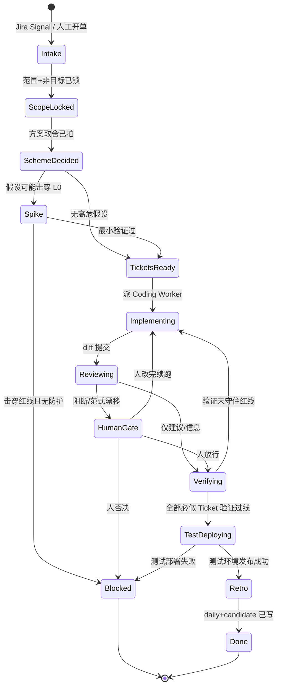

# dev-pipeline

公司内部 AI Native 开发流程的编排仓库：以 Temporal 为内核，调度写码 Worker、Code Review Worker、验证与 Retro，并与 Jira、RAG 及其他 Agents 配合。

本仓库独立于 `agent-platform`。后期再对接，当前不拷贝、不实现 Agent Session 运行时。

Jira 项目：[dev-pipeline（DP）](https://weiperfect007.atlassian.net/jira/software/projects/DP/boards/34)。票只写在 Jira，本仓库不维护 `TASKS.md`。Jira 只镜像流程状态，不当编排器。

## 当前阶段

[DP-9](https://weiperfect007.atlassian.net/browse/DP-9) 父 Workflow 骨架进行中：合法阶段转移（含已锁定的 `TestDeploying`）、人工门禁，以及 [DP-26](https://weiperfect007.atlassian.net/browse/DP-26) 的最小编排规则（依赖拓扑、并行、单张失败不自动取消同胞）已按测试落地。本地开发脚手架与必填配置根目录见 [DP-29](https://weiperfect007.atlassian.net/browse/DP-29) 与 `docs/dev-setup.md`。

真实 Coding / Review LLM Worker、Cursor CLI 运行时和 `agent-platform` 对接尚未实现。不要把本仓库当成整条流水线已经完成。

协作约定与代码规范已从 `common-worker` / `agent-platform` 迁入并适配，包名 `dev_pipeline`。Jira 项目 Key 已定为 `DP`。`docs/CHARTER.md` 中的 L0 已于 2026-11-10 冻结。远程仓库为 [JoeSmile/dev-pipeline](https://github.com/JoeSmile/dev-pipeline)。

开工先读 `plans/AI-CONTEXT.md`、`AGENTS.md`、`docs/CHARTER.md`。状态机与契约见下文与 `docs/architecture/dev-pipeline.md`。

## 推荐形态

父 Workflow `DevPipelineWorkflow` 只管阶段、门禁、Jira 同步、预算与幂等。一条父执行对应一张 Story。写码、RAG、双 Review、验证是 Activity 或 Child，不把 agent loop 写进 Workflow。每张实现 Ticket 由独立、可幂等的 Child（`TicketWorkflow`，幂等键 `ticket_id + execution_id`）执行。

`Implementing` → `Reviewing` →（必要时 `HumanGate`）→ `Verifying` 循环发生在 Child 上；父执行在 `TicketsReady` 之后以聚合阶段 `Implementing` 等待，直到全部必做 Ticket 验证过线。Coding Worker 只碰授权 worktree；Review Worker 默认只读 diff。互辩 / RAG / 多模型的预算闸门挂在父 Workflow：超限即停并记一条 Bad。

多 Ticket 按依赖拓扑执行：无依赖可并行；有依赖的 Ticket 不得提前开工。单张失败不自动取消同 Story 其他未受影响的 Ticket，但 Story 不能进入 `TestDeploying` 或 `Retro`，直到失败被处理（重试、人工从清单中移除，或 `abort`）。

## 流程状态机



上图中 `Implementing` / `Reviewing` / `HumanGate` / `Verifying` 循环发生在 Child Workflow 上，父执行在聚合阶段 `Implementing` 等待。阻断项打回须经 `HumanGate`（`review_override` 打回），不能从 `Reviewing` 自动跳过门禁回到 `Implementing`。`Reviewing` 若仅有建议/信息，可直接 `Verifying`；有阻断项或范式漂移必须 `HumanGate`。验证未守住红线则回到 `Implementing`。

全部必做 Ticket 验证过线后，父执行进入已锁定名称的 `TestDeploying`（2026-11-10 锁定，规则见 [DP-43](https://weiperfect007.atlassian.net/browse/DP-43)）。只有测试部署成功才允许进入 `Retro`；测试部署失败不得进入 `Retro`。不存在生产部署转移。可进入 `Blocked`：红线被击穿且无防护、测试部署失败，或人工否决 / `abort`。

## 阶段契约

| 阶段 | 输入 | 输出（进下一阶段的硬条件） |
|---|---|---|
| Intake | Jira key、reporter、原始诉求 | 规范化 Story 草稿；缺项标 `待证` |
| ScopeLocked | L0 Rule/Skill + Story 草稿 | 要解决 / 不做什么；禁止未锁范围就开编码 |
| SchemeDecided | 范围 + RAG 规范/历史事故 | 取舍记录；假设清单（红线级 / 局部）；全局 vs 局部 vs 候选 |
| Spike（可选） | 红线级假设 | 半小时～半天可证伪结果；失败则 Blocked 或补防护 |
| TicketsReady | 已拍方案 | Ticket 清单：目标、验收、依赖、I/O 契约 |
| Implementing | 单张 Ticket + worktree 权限 | 分支、diff、单测、回滚说明；幂等键 `ticket_id + execution_id`。父执行在此聚合等待 Child 循环 |
| Reviewing | diff + L0 + 本 Story 局部约束 | 双 Agent 并行：阻断 / 建议 / 信息 + 引用规则条文；无新证据就停 |
| HumanGate | 仅阻断项或跨模块/范式漂移 | 放行 / 打回 / 否决（Signal） |
| Verifying | 验收步骤 + L0 红线 | 「红线 ↔ 证据」至少一行；命令/现象可复现。全部必做 Ticket 过线后由父执行进入 `TestDeploying`，而不是直接 Retro |
| TestDeploying | 全部必做 Ticket 已验证过线 | 测试环境可达地址；失败则阻断，不得进入 Retro。禁止任何生产发布 |
| Retro | 当日证据（git、Jira、Codex session、评审）与成功的测试部署 | `docs/knowledge/daily/YYYY-MM-DD.md`；candidate 更新；全局草案等签批 |

## 人工 Signal

人只出现在这些点：

- `lock_scope` / `decide_scheme`：锁范围、拍方案
- `approve_spike`：高危假设是否接受防护后继续
- `review_override`：阻断项或范式漂移放行/打回/否决
- `promote_rule`：候选升 L0 / 全局 Skill（默认禁止自动升；本骨架仅记录请求，自动晋升一律拒绝）
- `abort` / `reopen`：中止或重开同一 Ticket / Story（必须开新 execution，不复用已乱掉的一次）

`abort` 会把父执行带入 `Blocked` 并留下可回放记录。本骨架尚未回收 worktree / 处理远程 PR（后续票）。`reopen` 在同一次执行上会被拒绝。

## 硬约束（L0，2026-11-10 冻结）

完整条文与一期工作默认见 `docs/CHARTER.md`。

1. Workflow 只做确定性编排；LLM 调用、写代码、检索、测试、外部 IO 全部落在 Activity / Child Worker。
2. 禁止静默升级全局 Rule / Skill / 本宪法；晋升必须人工 Signal。
3. 写码 Worker 只能改授权 repo/worktree；Review Worker 默认只读 diff。
4. 同一 Ticket 重跑必须幂等（`ticket_id` + `execution_id`），不得重复开 PR 或改乱分支。
5. Jira 只镜像状态，不当编排器；任务对错以可复现证据为准，不把 dry-run 或历史记录当成 PASS。
6. 互辩、RAG、多模型必须有预算闸门；无新证据即停。
7. 任何生产发布禁止。测试环境受控发布须另有明确授权。
8. 未确认 `lock_scope` / `decide_scheme` 前不得编码。
9. 单文件超过 2000 行视为 Review 阻断。
10. 执行过程必须可见：当前步骤提示与定期心跳，避免被当成挂死。进度不是催办；完整思考与密钥不进 History。本骨架提供可查询快照（当前阶段、等待的 Signal、各 Ticket 状态、测试部署状态）。

优先级：数据 / 任务不丢失 > 可观测与可回放 > 人工门禁清楚 > 迭代速度 > 极致性能。

## 技术栈（拟定）

- Python 3.12
- Temporal Python SDK
- Ruff（行宽 100）+ mypy strict + pytest

## 本地准备

远程仓库：[JoeSmile/dev-pipeline](https://github.com/JoeSmile/dev-pipeline)。L0 已冻结。Windows 是首选本地开发环境。配置根目录是必填的绝对路径，必须已经存在；缺失或无效时会立刻失败，不会回退到当前目录，也不会把它当成“可能已有”而继续。步骤见 `docs/dev-setup.md`。

本地 Temporal 默认地址为 `localhost:7233`。单元测试与 Workflow 测试使用 `temporalio.testing.WorkflowEnvironment`，不需要已启动的 Temporal 服务。

```powershell
python -m pytest
ruff check src tests
mypy
```
