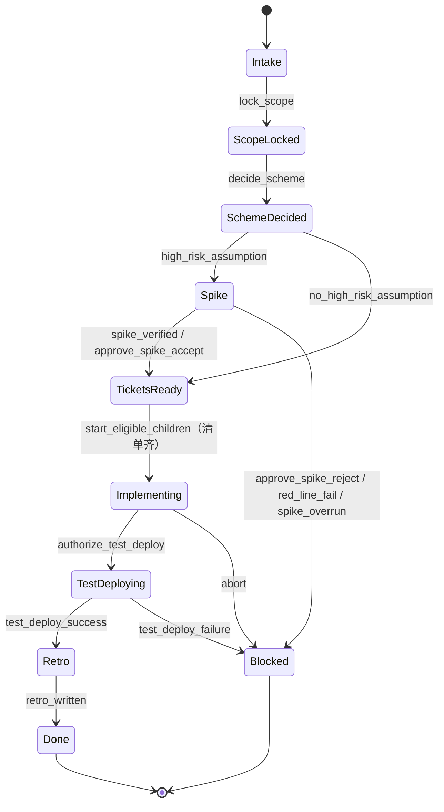

# DevPipeline 状态机（骨架说明）

父 Workflow `DevPipelineWorkflow` 只管阶段、门禁、Jira 同步、预算与幂等。一条父执行对应一张 Story。写码 / RAG / 双 Review / 验证是 Activity 或 Child，不把 agent loop 写进 Workflow。

正式架构图按 `AGENTS.md` 使用 Archify 产出；下文描述 [DP-9](https://weiperfect007.atlassian.net/browse/DP-9) 已落地的骨架：合法转移表、Child 循环，以及已锁定的 `TestDeploying`。

## 父与 Child

父执行与 Child 是两台状态机。父执行进入 `TestDeploying` 的边是 `Implementing → TestDeploying`，不是 `Verifying --> TestDeploying`。

### 父 Workflow（Story）

- 当前验收入口是 CLI `dev-pipeline start --jira-key DP-xx --config-root <绝对路径>`，启动后进入 Intake。CLI 与后续标签监听共用 `IntakeRecord`（Jira key、提出人、原始诉求、来源、是否带自动开跑标签；缺项标 `待证`），CLI 填写 `source=cli`。进入 Intake 后，Activity `normalize_story_draft` 把原始诉求整理成规范化 Story 草稿（要解决什么、已知约束、缺项列表；缺项标 `待证`，不臆造验收），写入查询快照 `story_draft`，作为后续 `lock_scope` 的输入。本阶段不锁范围、不开始编码。Jira 不当编排器。启动失败必须可见并中止，不得说成「可能已存在」。
- 父执行阶段变更会镜像到对应 Jira 票（默认是带前缀 `【DevPipeline 阶段镜像】` 的幂等评论；可选自定义字段名 / ID 仍为待证）。Temporal History 是真相。同步失败重试耗尽后，快照记录「镜像滞后」，并尽量在票上留下滞后标记；不得用 Jira 回写阶段。入站评论 / 字段变更不是编排指令。
- 父执行阶段：`Intake` → `ScopeLocked` → `SchemeDecided` →（可选 `Spike`）→ `TicketsReady` → 聚合 `Implementing` → `TestDeploying` → `Retro` → `Done`，或在门禁失败 / `abort` / 测试部署失败时进入 `Blocked`。
- 启动清单里的每张 Ticket 都是必做的。只有启动后的 `drop_ticket` 能把它从清单中移除；被移除的 Ticket 不再阻挡 `TestDeploying` / `Retro`。
- 只要仍有未移除 Ticket 处于 `Pending` / `Implementing` / `Reviewing` / `HumanGate` / `Verifying`，或失败尚未处理，父执行不得进入 `TestDeploying` 或 `Retro`。
- 全部未移除 Ticket 验证过线后，父执行仍停在聚合 `Implementing`，查询快照提示正在等候 `authorize_test_deploy`。没有该 Signal 不得发布，也不得进入 `Retro`。授权后进入 `TestDeploying`。只有测试部署成功才允许 `Retro`。测试部署失败不得进入 `Retro`。不存在生产部署转移。

### Child Workflow（Ticket）

```mermaid
stateDiagram-v2
    [*] --> Pending
    Pending --> Implementing: dependencies_satisfied
    Implementing --> Reviewing: diff_submitted
    Reviewing --> HumanGate: blocking_or_paradigm_drift
    Reviewing --> Verifying: advisory_only
    HumanGate --> Implementing: review_override_rework
    HumanGate --> Verifying: review_override_approve
    HumanGate --> Blocked: review_override_reject
    Verifying --> Implementing: verify_failed
    Verifying --> Verified: verify_passed
    Verified --> [*]
```

- Child（`TicketWorkflow`）从 `Pending` 开始。依赖未过线时不得进入 `Implementing`（即使 Child 被直接启动）。
- 循环：`Implementing` → `Reviewing` →（阻断或范式漂移时 `HumanGate`）→ `Verifying`。进入 Reviewing 前必须交付分支、diff、单测与回滚说明，记录在既有快照 `tickets[].deliverables` / Child `snapshot.deliverables`。缺项不得进入 Reviewing。仅建议/信息可从 `Reviewing` 直达 `Verifying`；阻断项或范式漂移必须 HumanGate，交付完成不等于 Review 通过。验证失败回到 `Implementing`。双 Review 本身见 DP-22，本骨架仍使用审查桩。
- 写码默认不自动 `push`、不自动合并、不自动改全局规则、不开远程 PR（[DP-31](https://weiperfect007.atlassian.net/browse/DP-31)）。开 PR 的授权条件标 `待证`，默认视为未授权，只在授权 worktree 产生产物。指向生产的 push / 合并 / 发布必须被拒，并写入 `snapshot.remote_write_rejections`。测试环境受控发布见 [DP-43](https://weiperfect007.atlassian.net/browse/DP-43)，必须落在授权目标 `test` 内；本票不实现该部署。

## 编排粒度（DP-26）

一条父 `DevPipelineWorkflow` 对应一张 Story；每张实现 Ticket 对应一个独立、可幂等的 Child（`TicketWorkflow`）。不另做第二套父 / Child 模型，不引入「可延后 Ticket」。

- Ticket 按依赖拓扑执行：无依赖的 Ticket 可并行启动；依赖未过线的 Ticket 不得提前开工。
- 单张 Child 失败（实现失败、验证未过线打回 Implementing、或否决进入 Blocked）不自动取消同 Story 其他未受影响的 Ticket。父执行在失败被处理前不得进入 `TestDeploying` 或 `Retro`。全部未移除的必做 Ticket 验证过线后才允许进 Retro。
- 失败处理路径：打回重做（`review_override` 打回或验证未过线只让该 Ticket 回到 `Implementing`；已 Failed / 否决 Blocked 的票用同一次执行内的 `retry_ticket`）、人工放弃并改清单（`drop_ticket`；`submit_tickets` 只用于 TicketsReady 补齐清单，清单齐后不能再用它改写清单），或对 Story `abort`。`abort` 会取消仍在运行的 Child，再以可回放结果进入 `Blocked`，并回收本 execution 创建的未合并工作区；已有远程 PR 待人工处理（标记方式待证）。这不是单张失败后的自动取消。
- 幂等键：`ticket_id+execution_id`（`ticket_workflow_id`，同时用作 Child workflow id）。Child 启动使用 `REJECT_DUPLICATE`，第二次启动会附着到已有 execution，而不是再开一个 Child。
  - 同键、仍在进行中：视为重入，不创建第二份副作用（工作区 / 分支 / PR 声明）。
  - 同键、已完成：返回已有结果，不开新分支 / PR / worktree。
  - 不同 `execution_id`（含 `reopen`）：新键、新工作区声明；不得继跑或 signal 旧 Child。
- `retry_ticket` 是同一次执行内对同一 Child 的重试，不分配新的 `execution_id`，也不再声明一份工作区。
- `reopen` 必须使用新的 `execution_id` 启动新的父执行，不能在已损坏的本次执行上恢复。只在 `Blocked` 或 `Done` 时接受；由 Activity `start_reopened_workflow` 用 Temporal Client 启动独立新执行（不用 Continue-As-New，也不作为会随父关闭而结束的 Child）。新执行只读继承范围、方案、假设和已关闭 Ticket 的证据，使用新工作区，不再写入旧 execution。
- `abort` 会取消仍在运行的 Child，写入可回放的 `abort_record`，并由 Activity `recycle_aborted_execution` 回收本 execution 创建的未合并 worktree / 本地分支。已有远程 PR 不关闭也不合并，只记录待人工处理（标记方式待证）。History 不予删除。

## 契约摘要

| 阶段 | 进入下一阶段的硬条件 |
|---|---|
| Intake | 规范化 Story 草稿（`snapshot.story_draft`），缺项标待证；不锁范围 |
| ScopeLocked | 要解决 / 不做什么已锁，并写入执行记录（锁定人、时间）；`reopen` 只读继承 |
| SchemeDecided | 取舍记录 + 假设分级（红线 / 局部 / 候选） |
| Spike | 可证伪结论写入 `snapshot.spike`；验证过进 TicketsReady；击穿红线且无防护或超时未验证则 Blocked；有防护须经 `approve_spike`。过线后不直接 Implementing，不派 Coding Child |
| TicketsReady | 每张票有目标、验收、依赖、I/O 契约；清单齐后进入 Implementing 并为每张必做票建立 Child。票写入 Jira 项目 DP，不写 TASKS.md |
| Implementing | 分支、diff、单测、回滚说明；幂等键 `ticket_id + execution_id`。父执行在此等待 Child |
| Reviewing | 双 Agent 并行输出阻断/建议/信息，并引用规则条文；无新证据即停 |
| HumanGate | 人工 Signal `review_override`：放行进 Verifying、打回仅该 Ticket 回 Implementing、否决使该 Child 进 Blocked（父执行不自动 Blocked）。决策写入 `review.override`。未出 Signal 不越过，无超时自动放行 |
| Verifying | 至少一行「红线 ↔ 证据」，命令或现象可复现；证据 UTF-8 落在授权 worktree，记录在 `snapshot.verify`。dry-run 或仅 History 不能标 PASS。未守住红线只打回该 Ticket。全部未移除 Ticket 过线且已授权后，由父执行从聚合 Implementing 进入 TestDeploying |
| TestDeploying | 已收到 authorize_test_deploy；测试环境可达地址；失败则阻断，不得进入 Retro。禁止任何生产发布。测试环境部署本身见 DP-43；本阶段只拒绝生产 / 非测试目标 |
| Retro | 写入 `docs/knowledge/daily/YYYY-MM-DD.md`（追加，不覆盖同日其他 Story），更新 candidates 的命中 / 硬近失；不得自动升 L0 / 全局 Skill。记录在 `snapshot.retro`。写完进 Done |

## 人工 Signal

`lock_scope`、`decide_scheme`、`approve_spike`、`review_override`、`authorize_test_deploy`、`promote_rule`、`retry_ticket`、`drop_ticket`、`abort`、`reopen`（重开必须新 execution）。`promote_rule` 必填候选标识、晋升目标（L0 / 全局 Skill）、理由与证据引用；合法且已达默认条件（命中 N≥2 或一次硬近失）时写入 candidate 并记入 `snapshot.promotion`。自动晋升一律拒绝。没有 `authorize_test_deploy` 不得发布到测试环境。错误阶段或非法 payload 被拒绝时记入 `last_rejection`，不改变当前阶段。字段、必填与拒绝条件见 README 表格与 `src/dev_pipeline/signal_schemas.py`。

进度可见性（[DP-27](https://weiperfect007.atlassian.net/browse/DP-27)，细则见 [DP-47](https://weiperfect007.atlassian.net/browse/DP-47)）挂在现有父执行 Query `snapshot` 上，不另开第二套 Query：当前阶段、正在等待的 Signal、各 Ticket / Child 状态、测试部署状态、已锁范围（`scope`：要解决 / 不做什么 / 锁定人 / 时间）、[DP-12](https://weiperfect007.atlassian.net/browse/DP-12) 的已花费预算（`budget`：已用 / 限额 / 剩余 / `last_breach`）、最近失败原因，以及 Jira 镜像是否滞后。执行过程快照在 `snapshot.progress`：当前步骤、最近心跳时间、心跳是否过期、最近有限条步骤提示。等候人工 Signal 时显示「正在等候你确认××」，不得显示成无响应；心跳过期只标「可能无响应」，与 Failed / Blocked / 等候 Signal 可区分，且不因显示过期就把 Workflow 判失败。步骤与心跳来自本 execution 证据目录下的 UTF-8 进度日志和 Activity heartbeat，完整进度与模型思考不得写入 History。写码交付物仍挂在 `tickets[].deliverables`。心跳间隔与显示过期阈值为待证占位。CLI `dev-pipeline status` 只读打印这些字段，并可用 `--follow` 持续刷新（[DP-28](https://weiperfect007.atlassian.net/browse/DP-28)）。`dev-pipeline signal` 发送既有人工 Signal，拒绝时呈现 `last_rejection` 且不改变阶段；操作无需产品界面。MCP / BA 视图分别是 [DP-38](https://weiperfect007.atlassian.net/browse/DP-38) 与 [DP-42](https://weiperfect007.atlassian.net/browse/DP-42)。命令与退出码契约见 README 与 [plans/superpowers/DP-28.md](../../plans/superpowers/DP-28.md)。

## 配置根目录

启动 Worker 必须显式传入已存在的绝对路径 `--config-root`。缺失或无效必须可见地失败，见 `docs/dev-setup.md`。Workflow 模块本身不做文件系统访问；校验发生在 Worker 入口与 `validate_config_root` Activity。Windows 是第一开发环境：本仓库 Worker 默认连接已运行的官方 Temporal `127.0.0.1:7233`（容器 `agent-platform-temporal-1`），不要在本仓库再起一份临时 Temporal。

配置根目录必须包含 `budget.toml`（样例见 `docs/examples/budget.toml`）。计量单位与限额可配置；数字在签批前标为待证，缺失或非法时以中文错误失败，不使用隐藏默认限额。父执行在 bootstrap 时通过 `load_budget_config` Activity 装入账本。互辩 / 检索 / 多模型桩必须经父执行闸门 `start_costly_path` 才能启动；超限即停并记 `Bad`，无新证据则只停该路径。超限不取消同 Story 其他 Ticket。
